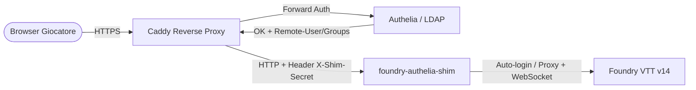

# foundry-authelia-shim

[](https://nodejs.org/)
[](https://opensource.org/licenses/MIT)
[](https://foundryvtt.com/)

Un proxy di autenticazione leggero (forward-auth shim) scritto in **Node.js** progettato per posizionarsi in modo trasparente tra un reverse proxy (**Caddy** + **Authelia** / LDAP / SSO) e **Foundry VTT v14**.

Garantisce il **Single Sign-On (SSO)** e l'**auto-login istantaneo** dei giocatori nel loro account Foundry, applicando restrizioni di sicurezza granulari (RBAC) **senza modificare alcun file sorgente di Foundry**, rendendo la configurazione totalmente immune e persistente agli aggiornamenti del software.

---

## 📐 Architettura



1. **Caddy** autentica l'utente tramite Authelia ed estrae gli header di identità (`Remote-User`, `Remote-Groups`).
2. La richiesta viene inoltrata a **foundry-authelia-shim** con l'header di sicurezza `X-Shim-Secret`.
3. Lo **shim**:
   - Interroga Foundry tramite **Socket.io** (`getJoinData`) per trovare l'ID utente corrispondente.
   - Esegue l'accesso automatico (POST `/join` con cookie di sessione validi e header `Sec-Fetch-Site: same-origin`) e reindirizza subito il giocatore alla schermata di gioco (`/game`).
   - Impedisce ai giocatori normali di effettuare l'accesso come altri utenti.
   - Blocca le pagine amministrative sensibili (`/setup`, `/auth`, `/players`, ecc.) a chi non appartiene al gruppo admin.
   - Inoltra il 100% del restante traffico (inclusi i flussi continui **WebSocket**) direttamente a Foundry.

---

## ✨ Funzionalità

- 🚀 **Auto-Login Istantaneo (`GET /join`)**: Il giocatore atterra su Foundry ed è già loggato nel proprio personaggio/utente, senza dover selezionare il nome o inserire password.
- 🔀 **Bypass Auto-login per Test (`?noauto`)**: Aggiungendo `?noauto=1` all'URL `/join` è possibile visualizzare la classica schermata di login di Foundry (utile per debug o manutenzione).
- 🛡️ **Controllo Accessi & RBAC**:
  - **Giocatori (`ROLE_PLAYER`)**: Possono accedere unicamente come se stessi. Qualsiasi tentativo di impersonare altri utenti via `POST /join` viene rifiutato con `403 Forbidden`.
  - **Amministratori (`ROLE_ADMIN`)**: Possono visualizzare la schermata completa di join per accedere con qualsiasi utente o passare alla gestione GM (`AUTO_LOGIN_ADMIN=false` di default).
  - **Protezione rotte di setup**: Percorsi critici come `/setup`, `/auth`, `/license`, `/update`, `/create`, `/players` sono categoricamente inibiti ai non-amministratori.
- 🔌 **Supporto Completo WebSocket**: Handshake e streaming bidirezionale WebSocket (`proxy.ws`) mantenuti attivi senza latenza.
- 🔒 **Sicurezza End-to-End**:
  - Verifica temporale sicura (`crypto.timingSafeEqual`) dell'header `X-Shim-Secret` per prevenire attacchi timing.
  - Lo shim lavora esclusivamente su interfaccia di loopback (`127.0.0.1`), proteggendo la porta upstream di Foundry.
- 🔄 **Compatibilità Foundry V14**: Gestisce nativamente i requisiti di sessione e sicurezza introdotti in Foundry V14 (`Sec-Fetch-Site: same-origin`, session cookie extraction).
- 🏷️ **Mappatura Utenti Flessibile (`USER_MAP`)**: Permette di associare nomi utente SSO a nomi Foundry differenti con spazi o caratteri speciali (es. `mario.rossi=Mario Rossi`).

---

## 🚫 Cosa NON fa

- **Non crea automaticamente gli utenti su Foundry**: l'utente deve essere già stato creato all'interno del mondo di Foundry con il medesimo nome utente SSO (o mappato via `USER_MAP`).
- **Non inserisce la password di amministrazione di sistema**: per l'accesso a `/setup` l'amministratore dovrà comunque inserire la Admin Access Key di Foundry.
- **I giocatori su Foundry devono avere la password (access key) VUOTA**: l'autenticazione è delegata al 100% ad Authelia (2FA / Duo / Passkey).

---

## 📋 Requisiti

- **Node.js** >= 20.x
- **Foundry VTT** v14 (o v13/v12 con architettura socket standard)
- **Caddy** (con modulo reverse proxy e forward auth configurato)
- **Authelia** (con backend LDAP/LLDAP o file utenti)

---

## ⚙️ Variabili d'Ambiente

Crea un file di configurazione (es. `/etc/foundry-shim.env`) partendo dal template [.env.example](file:///.env.example):

| Variabile | Valore di Default | Descrizione |
| :--- | :--- | :--- |
| `PORT` | `30001` | Porta TCP su cui lo shim è in ascolto |
| `HOST` | `127.0.0.1` | Interfaccia IP su cui ascoltare (raccomandato `127.0.0.1`) |
| `UPSTREAM` | `http://127.0.0.1:30000` | Indirizzo del server Foundry VTT locale |
| `HEADER_USERNAME` | `remote-user` | Header contenente lo username autenticato da Authelia |
| `HEADER_GROUPS` | `remote-groups` | Header contenente i gruppi dell'utente |
| `GROUPS_SEPARATOR`| `,` | Separatore dei gruppi nell'header |
| `ROLE_ADMIN` | `foundry-admin` | Gruppo abilitato ai permessi amministrativi di Foundry |
| `ROLE_PLAYER` | `foundry-player` | Gruppo abilitato all'accesso come giocatore |
| `SHIM_SECRET` | _(vuoto)_ | Segreto condiviso con Caddy (`X-Shim-Secret`). Raccomandato! |
| `PUBLIC_ORIGIN` | _(vuoto)_ | Dominio pubblico HTTPS (es. `https://foundry.example.com`) |
| `FORWARDED_PROTO`| `https` | Protocollo inoltrato ad upstream |
| `AUTO_LOGIN` | `true` | Esegue auto-login all'apertura di `GET /join` |
| `AUTO_LOGIN_ADMIN`| `false` | Se `true`, effettua l'auto-login automatico anche per gli admin |
| `USER_MAP` | _(vuoto)_ | Mappatura personalizzata: `ssouser1=Nome Foundry,sso2=Altro` |
| `DEBUG` | _(vuoto)_ | Impostare a `1` o `true` per abilitare i log di debug dettagliati |

---

## 🚀 Installazione e Avvio Rapido

### 1. Clona o copia i file sul server
```bash
sudo mkdir -p /opt/foundry-shim
sudo chown -R $USER:$USER /opt/foundry-shim
# Copia server.mjs, package.json nel percorso di destinazione
cp server.mjs package.json /opt/foundry-shim/
cd /opt/foundry-shim
npm install --omit=dev
```

### 2. Genera un segreto condiviso
```bash
openssl rand -hex 24
```

### 3. Configura le variabili d'ambiente
Crea `/etc/foundry-shim.env` e imposta i permessi restrittivi:
```bash
sudo nano /etc/foundry-shim.env
```
Inserisci la configurazione:
```env
PORT=30001
HOST=127.0.0.1
UPSTREAM=http://127.0.0.1:30000
ROLE_ADMIN=foundry-admin
ROLE_PLAYER=foundry-player
SHIM_SECRET=incolla_qui_il_segreto_generato
PUBLIC_ORIGIN=https://foundry.example.com
```
Proteggi il file:
```bash
sudo chmod 600 /etc/foundry-shim.env
```

### 4. Configura il Servizio Systemd
Copia il file `foundry-shim.service` in `/etc/systemd/system/`:
```bash
sudo cp foundry-shim.service /etc/systemd/system/foundry-shim.service
sudo systemctl daemon-reload
sudo systemctl enable --now foundry-shim
```
Controlla lo stato e i log:
```bash
sudo systemctl status foundry-shim
journalctl -u foundry-shim -f
```

---

## 🌐 Configurazione Reverse Proxy (Caddy)

Nel tuo `Caddyfile`, instrada il traffico verso lo shim sulla porta `30001` invece che direttamente a Foundry, inviando l'header `X-Shim-Secret`:

```caddy
foundry.example.com {
    # 1. Forward Auth con Authelia
    forward_auth authelia:9091 {
        uri /api/verify?rd=https://auth.example.com/
        copy_headers Remote-User Remote-Groups
    }

    # 2. Proxy verso lo shim
    reverse_proxy 127.0.0.1:30001 {
        header_up X-Shim-Secret "incolla_qui_il_segreto_generato"
    }
}
```
Ricarica Caddy con:
```bash
sudo systemctl reload caddy
```

---

## 🛡️ Regole Authelia (`access_control`)

Configura le regole di accesso in `configuration.yml` di Authelia:

```yaml
access_control:
  rules:
    # 1. Endpoint amministrativi: solo per il gruppo admin
    - domain: 'foundry.example.com'
      resources: ['^/(setup|auth|license|update|create|players)(/.*)?$']
      subject: 'group:foundry-admin'
      policy: two_factor

    # 2. Accesso generale al gioco: admin e giocatori
    - domain: 'foundry.example.com'
      subject: ['group:foundry-player', 'group:foundry-admin']
      policy: two_factor
```

---

## 🔒 Sicurezza e Buone Pratiche

1. **Blocca la porta 30000 all'esterno**: Foundry deve rimanere accessibile solo in locale (`127.0.0.1:30000`). Nessun utente esterno deve poter raggiungere Foundry direttamente bypassando Authelia e lo shim:
   ```bash
   ss -tlnp | grep 30000
   ```
2. **Usa `SHIM_SECRET`**: Impedisce a qualsiasi processo locale non autorizzato di effettuare chiamate dirette allo shim senza passare dal reverse proxy.
3. **Password Utenti Foundry**: Gli account utente su Foundry devono avere password vuota affinché lo shim possa completare l'autenticazione automatica. La sicurezza delle credenziali è affidata interamente ad Authelia con eventuale 2FA/MFA.

---

## 🛠️ Risoluzione dei Problemi (Troubleshooting)

- **I log dello shim**:
  ```bash
  journalctl -u foundry-shim -f
  ```
  *(Aggiungi `DEBUG=1` in `/etc/foundry-shim.env` e riavvia per avere log verbosi).*
- **`auto-login: no Foundry user named "..."`**:
  Il nome utente autenticato da Authelia non corrisponde ad alcun utente all'interno del mondo di Foundry aperto. Verifica la corrispondenza esatta o imposta una mappatura in `USER_MAP`.
- **`auto-login failed ... HTTP 4xx`**:
  Foundry ha rifiutato l'accesso. Motivi tipici:
  - L'utente ha una password impostata su Foundry (deve essere vuota).
  - L'utente è già connesso e la configurazione di Foundry ne impedisce sessioni multiple concorrenti.
- **`missing or wrong X-Shim-Secret`**:
  Il valore dell'header `X-Shim-Secret` inviato da Caddy non coincide con quello configurato in `SHIM_SECRET`.
- **Dopo un aggiornamento di Foundry**:
  Lo shim non altera alcun file interno di Foundry. In caso di breaking change nell'API di autenticazione di Foundry nelle future major release, gli unici punti rilevanti da verificare sono il payload di `POST /join` e l'evento Socket.io `getJoinData`.

---

## 📄 Licenza

Rilasciato sotto licenza [MIT](file:///LICENSE).
