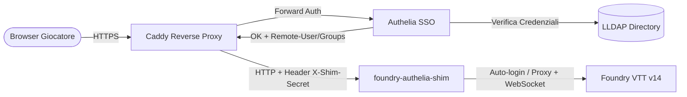

# foundry-authelia-shim

[](https://nodejs.org/)
[](https://opensource.org/licenses/MIT)
[](https://foundryvtt.com/)

Un proxy di autenticazione leggero (forward-auth shim) scritto in **Node.js** progettato per posizionarsi in modo trasparente tra un reverse proxy (**Caddy** + **Authelia** / **LLDAP**) e **Foundry VTT v14**.

Garantisce il **Single Sign-On (SSO)** e l'**auto-login istantaneo** dei giocatori nel loro account Foundry, applicando restrizioni di sicurezza granulari (RBAC) **senza modificare alcun file sorgente di Foundry**, rendendo la configurazione totalmente immune e persistente agli aggiornamenti di versione del software.

---

## 📐 Architettura



1. **Caddy** intercetta la richiesta HTTPS e la valida con **Authelia** via `forward_auth`.
2. **Authelia** verifica le credenziali e i gruppi dell'utente contro **LLDAP**.
3. Una volta autenticato, Caddy aggiunge gli header di identità (`Remote-User`, `Remote-Groups`) e il segreto `X-Shim-Secret`, inoltrando il traffico a **foundry-authelia-shim** sulla porta `30001`.
4. Lo **shim**:
   - Interroga Foundry tramite **Socket.io** (`getJoinData`) per identificare l'ID utente Foundry associato a `Remote-User` (o mappato via `USER_MAP`).
   - Esegue l'accesso automatico (POST `/join` con session cookie e header `Sec-Fetch-Site: same-origin`) e reindirizza subito il giocatore a `/game`.
   - Impedisce ai giocatori normali di impersonare altri utenti via `POST /join`.
   - Blocca l'accesso alle pagine amministrative (`/setup`, `/auth`, `/players`, `/license`, `/update`, `/create`) a chi non appartiene al gruppo admin.
   - Inoltra il 100% del restante traffico (inclusi i flussi continui **WebSocket**) direttamente ad upstream su Foundry (`127.0.0.1:30000`).

---

## ✨ Funzionalità

- 🚀 **Auto-Login Istantaneo (`GET /join`)**: Il giocatore viene autenticato tramite Authelia e si ritrova subito all'interno della sessione di gioco su Foundry, senza dover cliccare sul proprio nome o inserire chiavi di accesso.
- 🔀 **Bypass Auto-login per Test (`?noauto`)**: Aggiungendo `?noauto=1` all'URL `/join` è possibile visualizzare la classica schermata di login di Foundry (utile per test, debug o manutenzione).
- 🛡️ **Controllo Accessi & RBAC**:
  - **Giocatori (`ROLE_PLAYER`)**: Possono accedere unicamente come se stessi. Qualsiasi tentativo di join verso un altro utente viene respinto con `403 Forbidden`.
  - **Amministratori (`ROLE_ADMIN`)**: Possono visualizzare la schermata completa di join per accedere con qualsiasi utente o passare alla gestione GM (`AUTO_LOGIN_ADMIN=false` di default).
  - **Protezione rotte sensibili**: Percorsi critici come `/setup`, `/auth`, `/license`, `/update`, `/create`, `/players` sono categoricamente inibiti ai non-amministratori.
- 🔌 **Supporto Completo WebSocket**: Handshake e streaming bidirezionale WebSocket (`proxy.ws`) mantenuti attivi senza latenza o disconnessioni.
- 🔒 **Sicurezza End-to-End**:
  - Verifica a tempo costante (`crypto.timingSafeEqual`) dell'header `X-Shim-Secret` per prevenire attacchi timing.
  - Lo shim lavora esclusivamente su interfaccia di loopback (`127.0.0.1`), consentendo di schermare totalmente Foundry dall'esterno.
- 🔄 **Compatibilità Foundry V14**: Gestisce nativamente i requisiti di sessione e sicurezza introdotti in Foundry V14 (`Sec-Fetch-Site: same-origin`, session cookie extraction).
- 🏷️ **Mappatura Utenti Flessibile (`USER_MAP`)**: Permette di associare username SSO a nomi Foundry differenti con spazi o caratteri speciali (es. `mario.rossi=Mario Rossi`).

---

## 🚫 Cosa NON fa

- **Non crea automaticamente gli utenti su Foundry**: l'utente deve essere già stato creato all'interno del mondo di Foundry con il medesimo nome utente SSO (o mappato via `USER_MAP`).
- **Non inserisce la password di amministrazione di sistema**: per l'accesso a `/setup` l'amministratore dovrà comunque inserire la Admin Access Key di Foundry.
- **I giocatori su Foundry devono avere la password (access key) VUOTA**: l'autenticazione è delegata al 100% ad Authelia (2FA / Duo / Passkey / WebAuthn).

---

## 📦 Requisiti di Sistema e dello Stack

Per utilizzare `foundry-authelia-shim` sono necessari i seguenti componenti:

| Componente | Versione Raccomandata | Ruolo |
| :--- | :--- | :--- |
| **Node.js** | `>= 20.x LTS` | Runtime per l'esecuzione dello shim |
| **Foundry VTT** | `v14+` | Server di gioco virtual tabletop |
| **LLDAP** | Ultima versione | Server directory per gestione utenti e gruppi LDAP leggeri |
| **Authelia** | `>= 4.38` | Portale SSO & 2FA con endpoint forward-auth (`/api/verify`) |
| **Caddy** | `>= 2.8` | Reverse Proxy HTTPS con supporto nativo a `forward_auth` |

---

## 🛠️ Guida alla Configurazione dello Stack

### Passo 1: Configurazione LLDAP (Utenti e Gruppi)

1. Accedi alla Web UI di **LLDAP** (o usa le API).
2. Crea due gruppi dedicati (puoi personalizzare i nomi via `.env`):
   - `foundry-admin`: per Game Master e amministratori di sistema.
   - `foundry-player`: per i giocatori.
3. Crea gli utenti (es. `tiziano`, `giocatore1`, `giocatore2`) e assegnali ai rispettivi gruppi.
   > **Nota**: Il nome utente (`uid`) in LLDAP deve preferibilmente coincidere con il nome del giocatore impostato su Foundry VTT. Se differiscono (ad es. `mario.rossi` su LDAP e `Mario Rossi` su Foundry), usa la variabile d'ambiente `USER_MAP`.

---

### Passo 2: Configurazione Foundry VTT

1. Apri il tuo Mondo in Foundry VTT come Game Master / Admin.
2. Vai su **Impostazioni di Gioco** -> **Gestione Giocatori** (*Player Configuration*):
   - Assicurati che ogni utente abbia il **nome esatto** corrispondente allo username LDAP o alla mappatura `USER_MAP`.
   - **IMPORTANTE**: La **Chiave di Accesso (Password)** di ciascun giocatore deve essere lasciata **completamente VUOTA**. L'autenticazione è affidata interamente ad Authelia.
3. Assicurati che Foundry sia in ascolto sull'interfaccia locale (es. `127.0.0.1:30000`) o che la porta 30000 sia bloccata dal firewall verso l'esterno.

---

### Passo 3: Configurazione Authelia

Nel file di configurazione di Authelia (`configuration.yml`), imposta le regole di controllo accessi (`access_control`):

```yaml
access_control:
  default_policy: deny
  rules:
    # 1. Rotte amministrative di Foundry: consentite solo agli admin con 2FA
    - domain: 'foundry.tuodominio.it'
      resources:
        - '^/(setup|auth|license|update|create|players)(/.*)?$'
      subject: 'group:foundry-admin'
      policy: two_factor

    # 2. Accesso generale al gioco: per admin e giocatori con 2FA (o one_factor)
    - domain: 'foundry.tuodominio.it'
      subject:
        - 'group:foundry-player'
        - 'group:foundry-admin'
      policy: two_factor
```

Assicurati che Authelia inoltri gli attributi corretti nel profilo utente e riavvia Authelia.

---

### Passo 4: Configurazione Caddy Reverse Proxy

Nel tuo `Caddyfile`, instrada il traffico del dominio verso lo shim (porta `30001`) invece che direttamente a Foundry, inviando l'header `X-Shim-Secret`:

```caddy
foundry.tuodominio.it {
    # 1. Autenticazione tramite Authelia forward-auth
    forward_auth authelia:9091 {
        uri /api/verify?rd=https://auth.tuodominio.it/
        copy_headers Remote-User Remote-Groups
    }

    # 2. Reverse proxy verso foundry-authelia-shim
    reverse_proxy 127.0.0.1:30001 {
        header_up X-Shim-Secret "INCOLLA_QUI_IL_SEGRETO_GENERATO"
    }
}
```

Ricarica la configurazione di Caddy:
```bash
sudo systemctl reload caddy
```

---

### Passo 5: Installazione e Avvio dello Shim

#### 1. Clona il repository sul server
```bash
sudo mkdir -p /opt/foundry-shim
sudo chown -R $USER:$USER /opt/foundry-shim
git clone https://github.com/digennarot/foundry-authelia-shim.git /opt/foundry-shim
cd /opt/foundry-shim
npm install --omit=dev
```

#### 2. Genera il segreto condiviso
Genera una stringa casuale ad alta entropia che verrà condivisa tra Caddy e lo shim:
```bash
openssl rand -hex 24
```

#### 3. Configura le variabili d'ambiente
Crea il file `/etc/foundry-shim.env` partendo dal file di esempio [.env.example](file:///.env.example):
```bash
sudo cp .env.example /etc/foundry-shim.env
sudo nano /etc/foundry-shim.env
```

Configura i parametri secondo il tuo ambiente:
```env
PORT=30001
HOST=127.0.0.1
UPSTREAM=http://127.0.0.1:30000
ROLE_ADMIN=foundry-admin
ROLE_PLAYER=foundry-player
SHIM_SECRET=incolla_qui_il_segreto_generato_con_openssl
PUBLIC_ORIGIN=https://foundry.tuodominio.it
FORWARDED_PROTO=https
AUTO_LOGIN=true
AUTO_LOGIN_ADMIN=false

# Mappatura facoltativa (username SSO = Nome Foundry)
# USER_MAP=mario.rossi=Mario Rossi,giulia.g=Giulia GM
```

Imposta i permessi restrittivi (lettura solo per root / utente di servizio):
```bash
sudo chmod 600 /etc/foundry-shim.env
```

#### 4. Configura il Servizio Systemd
Copia il file di servizio pronto per la produzione:
```bash
sudo cp foundry-shim.service /etc/systemd/system/foundry-shim.service
sudo systemctl daemon-reload
sudo systemctl enable --now foundry-shim
```

Verifica lo stato del demone:
```bash
sudo systemctl status foundry-shim
```

---

## ⚙️ Riferimento Variabili d'Ambiente

| Variabile | Default | Descrizione |
| :--- | :--- | :--- |
| `PORT` | `30001` | Porta TCP su cui lo shim è in ascolto |
| `HOST` | `127.0.0.1` | Interfaccia IP su cui ascoltare (`127.0.0.1` per sicurezza) |
| `UPSTREAM` | `http://127.0.0.1:30000` | Indirizzo del server Foundry VTT locale |
| `HEADER_USERNAME` | `remote-user` | Header contenente lo username autenticato da Authelia |
| `HEADER_GROUPS` | `remote-groups` | Header contenente i gruppi dell'utente da Authelia |
| `GROUPS_SEPARATOR`| `,` | Separatore dei gruppi nell'header |
| `ROLE_ADMIN` | `foundry-admin` | Gruppo LLDAP abilitato ai privilegi amministrativi |
| `ROLE_PLAYER` | `foundry-player` | Gruppo LLDAP abilitato all'accesso come giocatore |
| `SHIM_SECRET` | _(vuoto)_ | Segreto condiviso con Caddy (`X-Shim-Secret`). Altamente raccomandato! |
| `PUBLIC_ORIGIN` | _(vuoto)_ | URL pubblico esterno (es. `https://foundry.tuodominio.it`) |
| `FORWARDED_PROTO`| `https` | Protocollo inoltrato ad upstream (`https` o `http`) |
| `AUTO_LOGIN` | `true` | Esegue auto-login all'apertura della pagina `GET /join` |
| `AUTO_LOGIN_ADMIN`| `false` | Se `true`, effettua l'auto-login automatico anche per gli admin |
| `USER_MAP` | _(vuoto)_ | Mappatura: `ssouser1=Nome Foundry,sso2=Altro Nome` |
| `DEBUG` | _(vuoto)_ | Imposta a `1` o `true` per abilitare i log di debug dettagliati |

---

## 🧪 Test e Verifica

1. **Test Giocatore**:
   - Apri una finestra anonima del browser e naviga su `https://foundry.tuodominio.it`.
   - Caddy reindirizza automaticamente al portale **Authelia**.
   - Effettua il login con un utente del gruppo `foundry-player` (e completa la 2FA).
   - Authelia autorizza e Caddy inoltra la richiesta allo shim: verrai reindirizzato direttamente dentro `/game` loggato con il tuo personaggio!
2. **Test Bypass Auto-Login**:
   - Accedi a `https://foundry.tuodominio.it/join?noauto=1`.
   - Lo shim salterà la procedura di auto-login mostrando la schermata di selezione utente standard.
3. **Test Protezione Admin**:
   - Da utente giocatore normale, prova ad accedere a `https://foundry.tuodominio.it/setup`.
   - Riceverai un messaggio `403 Forbidden: administrators only`.

---

## 🔒 Sicurezza e Buone Pratiche

1. **Blocca la porta 30000 all'esterno**:
   Foundry deve rimanere raggiungibile esclusivamente tramite `127.0.0.1:30000`. Nessun utente esterno deve poter raggiungere direttamente la porta di Foundry, altrimenti potrebbe bypassare Authelia.
   ```bash
   ss -tlnp | grep 30000
   ```
2. **Usa `SHIM_SECRET`**:
   Impedisce a processi locali o tentativi non autorizzati di bypassare Caddy contattando direttamente la porta dello shim (`30001`).
3. **Password Utenti Foundry**:
   I giocatori su Foundry devono avere la password vuota affinché lo shim possa completare l'autenticazione automatica. La sicurezza è garantita da Authelia (password forte, MFA/OTP, WebAuthn/Passkey, rate limiting).

---

## 🛠️ Risoluzione dei Problemi (Troubleshooting)

- **Visualizzare i log in tempo reale**:
  ```bash
  journalctl -u foundry-shim -f
  ```
  *(Se necessario, imposta `DEBUG=1` in `/etc/foundry-shim.env` e dai `sudo systemctl restart foundry-shim`).*
- **`auto-login: no Foundry user named "..."`**:
  Il nome utente autenticato da Authelia non coincide con alcun utente configurato nel mondo Foundry aperto. Verifica la corrispondenza maiuscole/minuscole o aggiungi la mappatura in `USER_MAP`.
- **`auto-login failed ... HTTP 4xx`**:
  Foundry ha rifiutato l'accesso. Cause tipiche:
  - L'utente ha una password (access key) impostata su Foundry (deve essere vuota).
  - L'utente ha già una sessione attiva aperta e Foundry rifiuta sessioni concorrenti.
- **`missing or wrong X-Shim-Secret`**:
  L'header `X-Shim-Secret` inviato dal `Caddyfile` non coincide con il valore specificato in `SHIM_SECRET`.
- **Aggiornamenti di Foundry**:
  Lo shim non tocca alcun file di Foundry. In caso di modifiche architetturali in future major release di Foundry, gli unici componenti da controllare sono il payload di `POST /join` e l'evento Socket.io `getJoinData`.

---

## 📄 Licenza

Rilasciato sotto licenza [MIT](file:///LICENSE).
